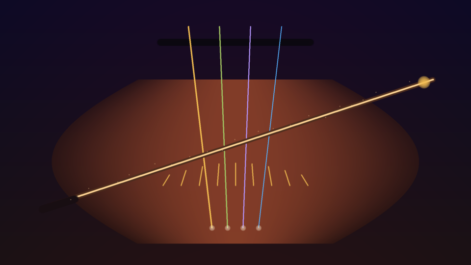

# QUARTET



A physical-modelling string quartet for [VIBE FM](https://github.com/Vibe-FM-SDK/vibe-fm-sdk): four slots, sixteen bowed-string voices and **one** clean-room C waveguide after McIntyre, Schumacher and Woodhouse — the model behind STK's `Bowed`. Keys and MIDI play only the selected slot, using that slot's articulation; pads 1–16 fire original Stravinsky-style four-part chords, and F3/PLAY runs a four-part arrangement of the riff in the supplied MIDI file. Reverb, chorus, delay and echo are built in. No samples, no impulse responses, no heap.

## Sound

- **One `BowedStringEngine`, four slots.** Violin, viola, cello and bass each get four voices; the same engine is re-voiced by preset and articulation, never copied into separate instruments.
- **Waveguide core.** Two fractional delay lines either side of the bow, the STK friction law `(|dv·slope + 0.001| + 0.75)⁻⁴`, a lossy string loop filter, stick–slip velocity injection and a little rosin noise.
- **14 articulations per slot.** Sustain vibrato / non-vibrato, legato, portamento, staccato, spiccato, tremolo, pizzicato, harmonics, trill, sul tasto, sul ponticello, marcato and double stops. They change bow position, envelope, pitch glide, excitation and resonance in the shared waveguide.
- **Body and FX.** Two bandpass body formants per preset, a bridge formant, adjustable reverb (four damped combs + allpasses per channel), stereo chorus, clean stereo delay and a two-tap echo. All fixed-memory; no IR files.
- **Unison and vibrato.** Section presets bow 2–3 slightly detuned strings per voice; vibrato has independent rate and depth with a per-string phase offset.
- **Eight presets.** SOLO VIOLIN, SECTION VIOLIN, SOLO VIOLA, SECTION VIOLA, SOLO CELLO, SECTION CELLO, DOUBLE BASS and OCTOBASS. The last two transpose down an octave and two octaves.
- **Out of scope.** Sympathetic-string coupling and sampled body IRs are not modelled; the formants and reverb above stand in for them.

## Playing

| Control | What it does |
|---|---|
| Keys / MIDI | Play **only the selected slot**, using that slot's articulation. Double Stops adds a fifth above in the same slot. |
| Pads 1–16 | Fire original octatonic / polychordal **Stravinsky-style chords**, one note per slot. |
| SHIFT + pad | The shortcut layer: pads 1–4 select a slot, 5/6 previous/next preset, 7 demo, 8 panic, 9–12 mute slots, 13–15 select slots 1–3, 16 unmute all. |
| F1 / ENC A | Next page. F2/F4 and ENC B browse presets. |
| F3 / PLAY | Start or stop the four-part MIDI riff demo. |
| F5 / HOME | The controls overview. F6 / REC = panic; K6 jumps to FX. |
| K1–K4 | SOUND · BOW · BODY · VIB / CHORD / STYLE. |
| K5 | Cycle CHAIRS · LEVELS · SPACE · FX · DELAY · ECHO · STYLE · SYSTEM. |
| DATA + ENTER | FOCUS: hold ENTER, DATA walks and edits every control on the page. |

Pages: **SOUND, BOW, BODY, VIB, CHORD, STYLE, CHAIRS, LEVELS, SPACE, FX, DELAY, ECHO, SYSTEM**. STYLE holds one articulation per slot; FX holds chorus and reverb decay/damping, with separate DELAY and ECHO pages. Set Pads to `CTRL` if you want the unshifted pads to behave as the shortcut layer instead.

## Two flows

`VIBE_PARALLEL_AUDIO` is on. The audio flow owns the waveguide voices and reads a snapshot of the parameters; the control flow owns events, drawing, storage and the editor bridge. Notes cross on a single-writer / single-reader ring, and levels cross as atomic 32-bit values. The display never holds up the sound.

## Layout

```
quartet/
  firmware/quartet/
    main.c          parameters, pages, styles, FX, pads, demo, editor bridge
    bowed.c/.h      the shared bowed-string engine
    chords.h        sixteen original quartet chords
    demo.h          generated four-part demo from firmware/demo/*.mid
    icon.png        generated 960x540 tile
    editor/         custom Editor page: chord pads + live sliders
    firmware.json
    wasmtest*.json
  scripts/
    build.ps1       Windows build wrapper
    fetch-sdk.sh    pinned SDK fetch
  tools/
    make_demo.py    regenerates demo.h
    make_icon.py    regenerates icon.png (stdlib only)
  sdk/              vendored VIBE FM SDK at 2ac2340
```

## Build

Windows:

```powershell
pwsh -File scripts/build.ps1
```

Any platform with `sh`, Zig 0.13.0, Python 3 and Node:

```sh
sh scripts/fetch-sdk.sh
python3 tools/make_demo.py
python3 tools/make_icon.py
sh sdk/tools/build.sh ../firmware/quartet
node sdk/tools/vibe-check.mjs sdk/build/quartet.wasm --manifest firmware/quartet/firmware.json
node sdk/tools/wasmtest.mjs sdk/build/quartet.wasm firmware/quartet/wasmtest.json out/
```

Drop `sdk/build/quartet.zip` onto the VIBE FM VST window to install it.

## Licence

Firmware: Apache-2.0. The VIBE FM SDK in `sdk/` is Apache-2.0, Copyright 2026 Sven Trogus (zvenson); see `sdk/LICENSE` and `sdk/NOTICE`. VIBE FM is a trademark — "built with the VIBE FM SDK" is fine, "VIBE FM compatible" or the logo need permission.
